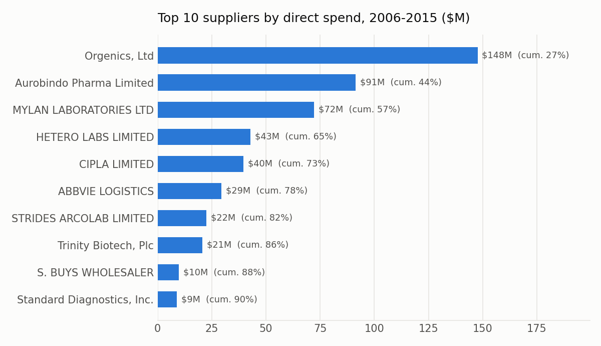
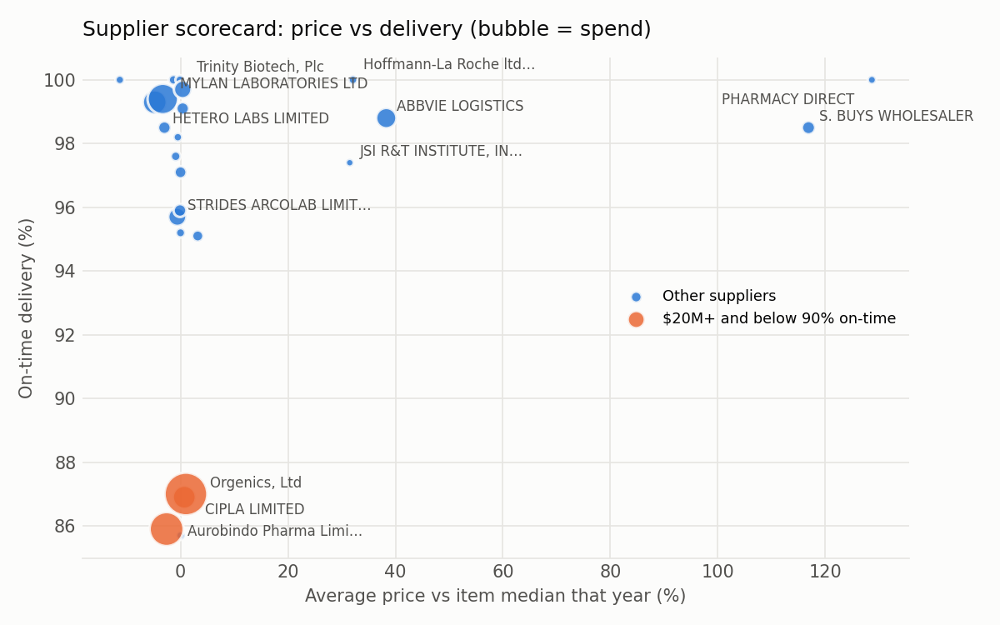
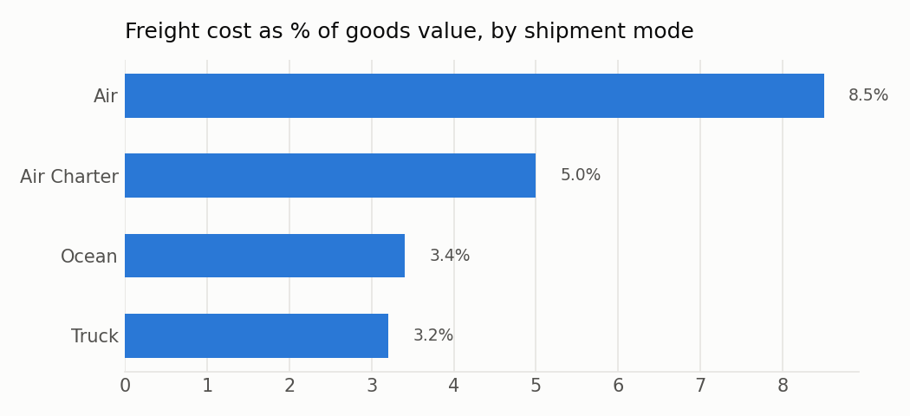
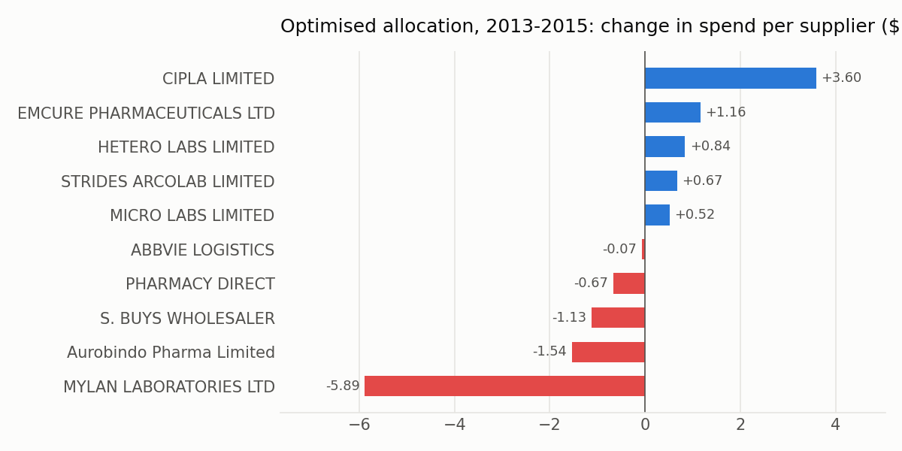

# SpendIQ: procurement spend analytics and supplier allocation

An analysis of **$1.63B of public-health procurement**: 10,324 order lines of HIV/AIDS medicines and test
kits bought by USAID's Supply Chain Management System (SCMS) for 43 countries, 2006–2015. It asks
four procurement questions and answers each one with code:

1. **Where does the money go?** Spend Pareto by supplier, product, country and shipment mode
2. **Are we paying different prices for the same thing?** Price variance per item and year
3. **Which suppliers are good?** Scorecard on price and on-time delivery
4. **Could the same volume be bought more cheaply without hurting delivery?** A linear program (PuLP)

## Key results

| Question | Result |
|---|---|
| Spend concentration | 67% of spend ($1,085M) is shipped from SCMS's own warehouses. Of the **$542M ordered directly from suppliers, 7 of 72 suppliers (10%) make up 80%** |
| Price variance | Paying every line the item's 25th-percentile price for that year would save at most **$66.1M (4.1%)**. The 657 lines priced 20%+ above the median are **small orders: median 211 packs vs 4,162** |
| Supplier performance | Three large suppliers (Orgenics, Aurobindo, Cipla) hold **$279M (51% of direct spend) at 86–87% on-time**, vs 94.7% for all direct suppliers |
| Freight | Air freight costs **8.5%** of goods value vs **3.2%** by truck and **3.4%** by ocean; air plus charter carry 54% of spend |
| Optimised allocation | For 30 multi-supplier items (2013–15, $106.7M), re-splitting volume saves **$2.53M (2.4%) at the same 97.1% on-time rate** |






## What the analysis recommends

- **Consolidate small orders.** Most of the price premium comes from small, urgent buys from wholesalers
  (S. Buys, Pharmacy Direct: 117–129% above median price), not from the main manufacturers, who sit at or
  below the median.
- **Work on delivery with the three largest late suppliers.** Their prices are fair; their lateness is the issue.
- **Re-split volume between suppliers already used.** It's a modest but low-risk 2.4%: no new suppliers,
  at most 1.5× any supplier's past volume, no new single-sourcing above 70%, and no loss of on-time rate.

## Method

| Step | Script | What it does |
|---|---|---|
| 0 | `src/step0_inspect.py` | Profiles the raw file: types, missing values, text hiding in number columns |
| 1 | `src/step1_clean.py` | Parses two date formats; splits freight/weight into number + reason (`See ID#…`, `included in price`, `invoiced separately`); adds delay, on-time, lead time |
| 2 | `src/step2_spend.py` | Spend Pareto (real suppliers only: "SCMS from RDC" is SCMS's warehouse, not a supplier) and other cuts |
| 3 | `src/step3_price_variance.py` | Same item, same year: each line vs the 25th-percentile price; drops 28 implausible prices (e.g. $0.01) |
| 4 | `src/step4_scorecard.py` | 24 suppliers (20+ lines): price score (−10% → 100, +30% → 0) and on-time score (100% → 100, 80% → 0), 50/50 |
| 5 | `src/step5_allocation.py` | Linear program (below), plus a sensitivity check on the capacity assumption |
| 6 | `src/step6_report.py` | Freight by shipment mode and the charts above |

**Allocation model** (item *i*, supplier *s*, quantity *x*):

```
minimise    Σ price[i,s] · x[i,s]
subject to  Σ_s x[i,s] = demand[i]                          every item's quantity is met
            0 ≤ x[i,s] ≤ 1.5 · actual[i,s]                  capacity
            x[i,s] ≤ max(70%, actual share[i,s]) · demand[i] no new single-sourcing
            Σ on_time[i,s] · x[i,s] ≥ actual on-time volume  delivery no worse than reality
```

The actual split satisfies every constraint, so the optimum can only match or beat reality.

| Capacity limit | 1.0× | 1.25× | 1.5× (base) | 2.0× |
|---|---|---|---|---|
| Saving | $0.00M | $2.00M | $2.53M | $2.78M |

## Limits, stated honestly

- **On-time** compares delivery to the client against the scheduled date, so it also covers the freight forwarder's part, not only the supplier's.
- **Lead time** exists only for direct orders with a recorded PO date (4,592 lines). Warehouse (RDC) orders have no supplier PO.
- **Prices** differ partly by order size, destination and INCO term, which neither the price benchmark nor the model sees. Treat $66.1M as a ceiling and $2.5M as an estimate.
- **Freight by mode** is descriptive: air is often chosen *because* an order is urgent or far away.
- **Freight on "See ID#" lines** belongs to a whole shipment, so it is not divided across lines.

## Run it

```bash
pip install -r requirements.txt
# put the CSV at data/raw/scms_delivery_history.csv (see Data below)
python run_all.py          # steps 1-6, about 30 seconds
python -m pytest -q        # 7 tests on hand-made data
```

## Data

*Supply Chain Shipment Pricing Data*, USAID (Supply Chain Management System project), licensed
**CC BY-ND**. The raw file is not included in this repository. Download it from the
[USAID catalog mirror](https://data.amerigeoss.org/dataset/supply-chain-shipment-pricing-data)
or Kaggle and save it as `data/raw/scms_delivery_history.csv`.

Tools: Python, pandas, PuLP (CBC or HiGHS solver), matplotlib, pytest.
